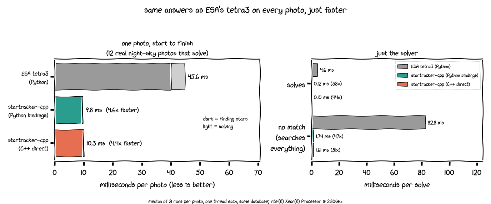

# startracker-cpp

A C++20 star tracker for Raspberry Pi, other ARM64 boards and x86-64. Point a camera at the
night sky and it tells you which way the camera is facing (a full 3-D attitude), many times
per second.

* **Lost in space:** it identifies stars with no prior knowledge, using ESA's tetra3
  algorithm. It gives the same answers as tetra3, a few times faster.
* **Tracking:** once it knows where it is pointing, it follows the sky frame to frame by
  looking only at small windows around the predicted stars. In the C++ benchmark this costs
  about 0.1 ms per frame on a desktop CPU (0.3 ms through Python).
* **Flight-style engineering:** no heap allocation after start-up, no exceptions, and a
  documented worst-case cost for every runtime function.
* **Interfaces:** C++, C (`libstartracker`) and Python.

## Run it on a Raspberry Pi

One command installs the packages, builds, downloads the right star database, and starts
tracking with your camera:

```sh
git clone https://github.com/kenchangh/startracker-cpp.git && cd startracker-cpp
scripts/raspi/run.sh --camera hq-16mm
```

* **Cameras:** `hq-12mm`, `hq-16mm`, `hq-25mm` (HQ Camera), `gs-12mm`, `gs-16mm` (Global
  Shutter Camera), `cm3` (Camera Module 3) and `cm2` (Camera Module 2). For any other lens,
  pass `--fov <degrees>`.
* **Useful options:**
  * `--exposure-ms 200 --gain 16` for exposure;
  * `--csv attitude.csv` to log each frame;
  * `--save-pgm frames/` to record frames;
  * `--bench` to measure speed on your Pi;
  * `--from-pgm frames/` to replay recorded frames without a camera.
* **Status:** not yet run on a Raspberry Pi or a real Pi camera. Everything around it is
  tested: arm64 CI, the capture code on simulated frames, and every camera preset on rendered
  star fields.

The full guide is in [docs/raspberry-pi.md](docs/raspberry-pi.md). It covers which lens to
pick, lens calibration, memory, real-time settings, and using C/C++ instead of Python.

## Benchmark: vs ESA's tetra3



The test set is 23 real night-sky photographs, every one giving the same answer as tetra3.
Each photo was processed three ways, using the same star database, on one CPU thread:

| median per photo | ESA tetra3 (Python) | startracker-cpp via Python bindings | startracker-cpp from C++ |
|---|---|---|---|
| **12 photos that solve**: find stars | 40.2 ms | 9.6 ms (4.2×) | 9.9 ms (4.0×) |
| solve | 4.60 ms | 0.122 ms (38×) | 0.105 ms (44×) |
| **total** | **45.6 ms** | **9.8 ms (4.6×)** | **10.3 ms (4.4×)** |
| **11 photos with no match**: find stars | 13.0 ms | 3.3 ms (4.0×) | 3.0 ms (4.4×) |
| search until giving up | 82.8 ms | 1.74 ms (47×) | 1.61 ms (52×) |
| **total** | **111 ms** | **5.7 ms (20×)** | **5.4 ms (21×)** |

* **How it was measured:**
  * Intel Xeon @ 2.80 GHz (4 vCPU container); each number is the median of 21 runs per photo.
  * tetra3 is ESA's Python library at commit f9fa2eb (NumPy/SciPy, limited to one thread).
* **Python bindings vs direct C++:**
  * Both run the same compiled code, so they land within a few percent of each other.
  * Run-to-run noise on this shared machine is larger than the binding overhead. That is why
    the bindings sometimes measure faster.
* **Where the time goes:** finding the stars in the image is about 95% of a lost-in-space
  frame. While tracking, the library skips that full-image search.
* **On arm64:** a GitHub-hosted Arm Neoverse N2 runner took 10.9 ms for a full 1280×960
  frame, 0.03 ms for tracking windows, and 0.04 ms for a solve (synthetic database).
* **Raspberry Pi:** no numbers yet. Run `scripts/raspi/run.sh --camera <yours> --bench`.
* **Reproduce:**
  * `tests/parity/speed_vs_tetra3.py` runs the comparison;
  * `docs/images/make_bench_chart.py` draws the chart;
  * the raw numbers are in `docs/images/bench_vs_tetra3.json`.

## What's inside

* **Lost-in-space solver:** a port of ESA tetra3 (@ f9fa2eb).
  * Parity: 404/404 parity cases; the worst boresight difference is 0.0016″.
  * Search limits: a deterministic work budget and an optional deadline.
  * Cedar Solve's improvements are available as opt-in variants (303/303 parity cases).
* **Centroider:** matches tetra3's `get_centroids_from_image` within 6e-5 px on 101 images.
  It also has hot-pixel maps, trail rejection, and a windowed (ROI) mode for tracking.
* **Tracker:**
  * matches predicted stars and fits the attitude (Wahba, SVD);
  * reports an attitude covariance and an estimated rotation rate;
  * has a gyro hook, and falls back to lost-in-space when it loses lock;
  * uses a calibrated camera model with lens distortion.
* **Pipeline:**
  * acquire → centroid → solve, single-threaded or one thread per stage;
  * lock-free queues, three drop policies, and per-frame timestamps;
  * frame sources: replay files and V4L2 cameras.
* **Databases:** converts tetra3/cedar `.npz` files, or generates new databases from
  Hipparcos or the Bright Star Catalogue. Generated pattern sets are identical to tetra3's.
* **Tools:**
  * `st_dbtool`: database generate, convert, info and verify;
  * `st_render`: synthetic star fields;
  * `st_sweep`: accuracy sweeps;
  * `st_replay`: recorded sequences;
  * `st_bench`: latency and memory.

## Build from source (desktop / CI)

Requires CMake ≥ 3.21, Ninja, and GCC ≥ 11 or Clang ≥ 14.

```sh
cmake --preset release && cmake --build --preset release && ctest --preset release
python3 tools/fetch_fixtures.py --dbtool build/release/tools/st_dbtool   # databases + test images
```

* **Presets:** `dev`, `release`, `release-asserts`, `asan` (ASan + UBSan), `tsan` and `fuzz`.
* **Fixtures:** test data is downloaded with SHA-256 checks and never committed. Tests that
  need it skip when it is missing.

## Using the library

**Python:**

```python
import startracker as st   # PYTHONPATH=python, STARTRACKER_LIB=build/release/src/libstartracker.so
t = st.Tracker(open("fixtures/cedar_default.stdb", "rb").read(), st.Camera.ideal(1280, 960, 14.0))
sol = t.track_image(image_uint16, t_ns=0)   # Solution(OK, lost_in_space, ra=..., dec=..., roll=...)
```

**C:**

```c
st_config cfg; st_config_init(&cfg);
cfg.camera = st_camera_ideal(1280, 960, 14.0);
size_t need = st_tracker_memory_size(&cfg, db, db_size);       /* db: the .stdb file in memory */
st_tracker* t; st_tracker_create(&cfg, db, db_size, aligned_alloc(64, need), need, &t);
st_solution s; st_track_image(t, t_ns, pixels, 1280, 960, 0, ST_MONO16, &s);
```

The C++ API, the file formats and the coordinate conventions are in
[docs/usage.md](docs/usage.md).

## Runtime guarantees and how they are checked

* **No heap after initialisation.**
  * All memory comes from a caller-provided arena.
  * `st_core` and `libstartracker` contain no allocation, exception or RTTI symbols; CI
    checks this with `nm`.
  * Unit tests fail on any heap allocation, including inside the multi-threaded pipeline.
* **No exceptions or RTTI.** The core builds with `-fno-exceptions -fno-rtti`, and errors are
  returned as status codes.
* **Dependencies:** the core depends only on the C++ standard library. POSIX pieces (mmap,
  threads, V4L2) are kept in `st_platform`.

## Verification

* **Parity against ESA tetra3 and cedar-solve:** the database generator, the solver on
  tetra3's own centroids, and the full image → centroids → solution chain.
* **Real sky:** 23 photographs plate-solved by astrometry.net. Every solution we report
  agrees with it (centre within about 1 px).
* **Synthetic tests:** sweeps over field of view, sensitivity, noise and rotation rate, and
  a sidereal-rotation test on rendered frames.
* **Robustness:** ASan/UBSan and TSan runs, fuzzing of the database loader and the
  centroider, clang-tidy, and strict per-header compiles.
* **Platforms:** CI runs on x86-64 and arm64 Linux (GCC 11–14, Clang 14–18) and on macOS.

Design notes for every phase are in [docs/design/](docs/design/); tetra3's quirks are
documented in note 03.

## License

Apache-2.0. See [NOTICE](NOTICE) for attribution: tetra3 (ESA), Cedar Solve, and Tetra.
