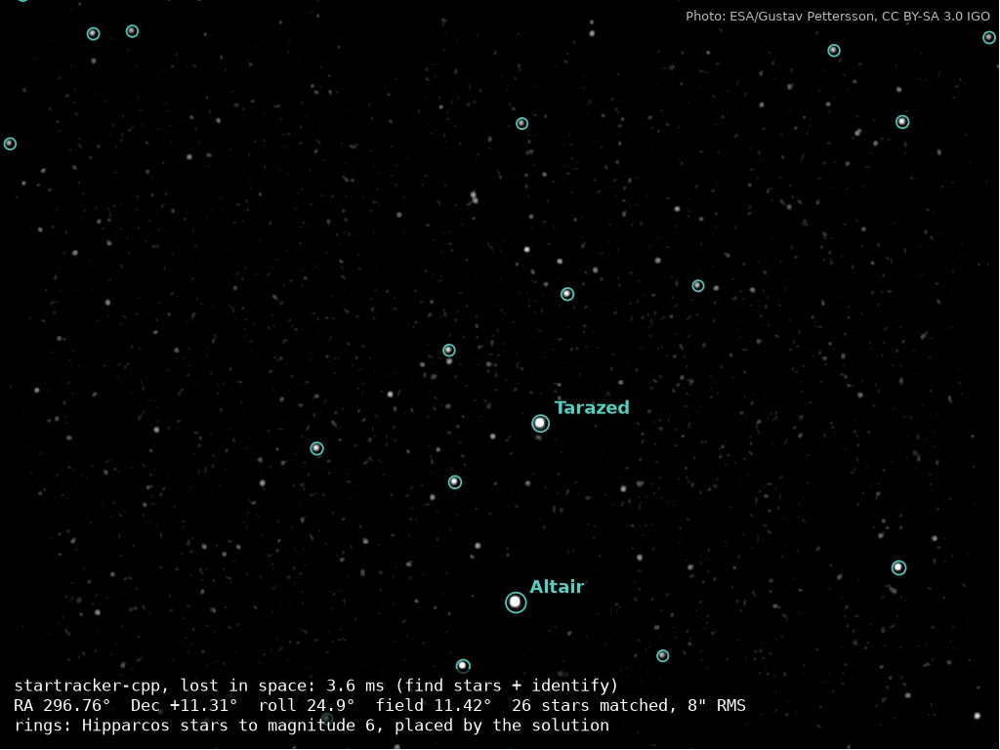

# startracker-cpp

A fast star tracker in C++20. Give it a night-sky image and it tells you exactly where the
camera is pointing. It gives the same answers as ESA's tetra3 and cedar-solve, about 5× faster.



*A real 1024×768 photo, solved with no prior knowledge in 3.6 ms. Each ring is a catalogue
star drawn where the solution says it should be. Photo: ESA/Gustav Pettersson, CC BY-SA 3.0 IGO.*

## Benchmark


The test set is 23 real night-sky photos. Each photo is timed start to finish (find the stars,
then identify them) on one thread, using each library's own star database. The table shows
the median per photo.

| vs ESA tetra3 | tetra3 | startracker-cpp | speed-up |
|---|---|---|---|
| 12 photos that solve | 16.4 ms | 3.3 ms | **4.9×** |
| 11 photos with no match | 35.2 ms | 2.2 ms | **16×** |

| vs cedar-solve | cedar-solve | startracker-cpp | speed-up |
|---|---|---|---|
| 19 photos that solve | 15.4 ms | 3.3 ms | **4.7×** |
| 2 photos where cedar-solve times out | 5006 ms (gave up) | 82 ms (finished) | **≥ 61×** |

* **Same answers:** startracker-cpp matches both libraries on every photo.
* **Setup:** Apple M3 Max; startracker-cpp is called through its Python bindings, so that
  overhead counts against it.
* **Tracking:** once locked on, it only looks around the predicted stars: about 0.1 ms per
  frame.

Method, caveats and how to reproduce: [docs/benchmark.md](docs/benchmark.md).

## Quick start

```sh
cmake --preset release && cmake --build --preset release
python3 tools/fetch_fixtures.py --dbtool build/release/tools/st_dbtool   # star databases + test photos
python3 tools/solve_images.py --dir ~/night_sky                          # solve a folder of JPEG/PNGs
```

The build needs CMake ≥ 3.21, Ninja, and GCC ≥ 11 or Clang ≥ 14.

From Python (`PYTHONPATH=python`, `STARTRACKER_LIB=build/release/src/libstartracker.so`):

```python
import startracker as st
t = st.Tracker(open("fixtures/cedar_default.stdb", "rb").read(),
               st.Camera.ideal(1280, 960, 14.0), variant="cedar")
sol = t.track_image(image)   # Solution(OK, lost_in_space, ra=..., dec=..., roll=...)
```

There is also a C API (`include/st/c/st.h`) and a C++ API. See [docs/usage.md](docs/usage.md).

**Raspberry Pi:** `scripts/raspi/run.sh --camera hq-16mm` installs, builds, downloads a star
database and starts tracking. It has not been run on real Pi hardware yet. See
[docs/raspberry-pi.md](docs/raspberry-pi.md).

## Design

* **Lost in space:** a port of ESA's tetra3, with cedar-solve's search as an option
  (`variant="cedar"`).
* **Tracking:** frame-to-frame tracking using small windows around the predicted stars, with
  lens distortion, attitude covariance and rate estimates.
* **Flight-style engineering:** no heap allocation after start-up, no exceptions, and a
  documented worst-case cost for every runtime function.
* **Tested:** checked for identical results against tetra3 and cedar-solve, against
  astrometry.net on real photos, and with sanitizers and fuzzing.

Details: [docs/engineering.md](docs/engineering.md). Design notes: [docs/design/](docs/design/).

## License

Apache-2.0. See [NOTICE](NOTICE) for attribution: tetra3 (ESA), cedar-solve and Tetra. The
example photo in `docs/images/solved_example.jpg` is ESA/Gustav Pettersson, CC BY-SA 3.0 IGO.
